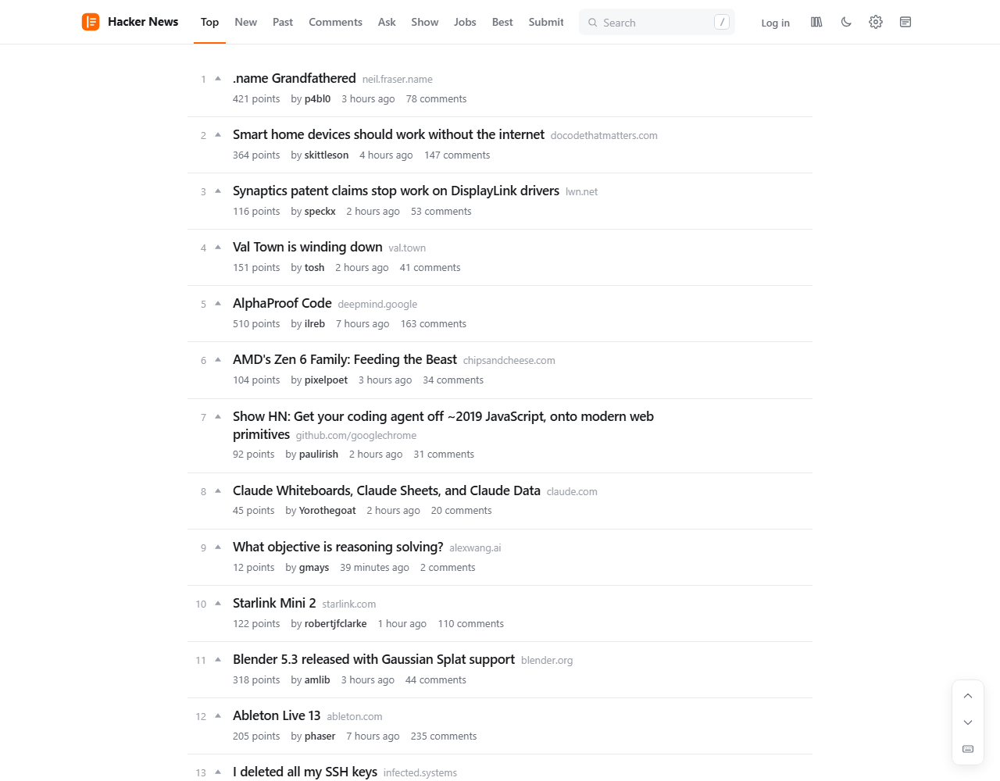
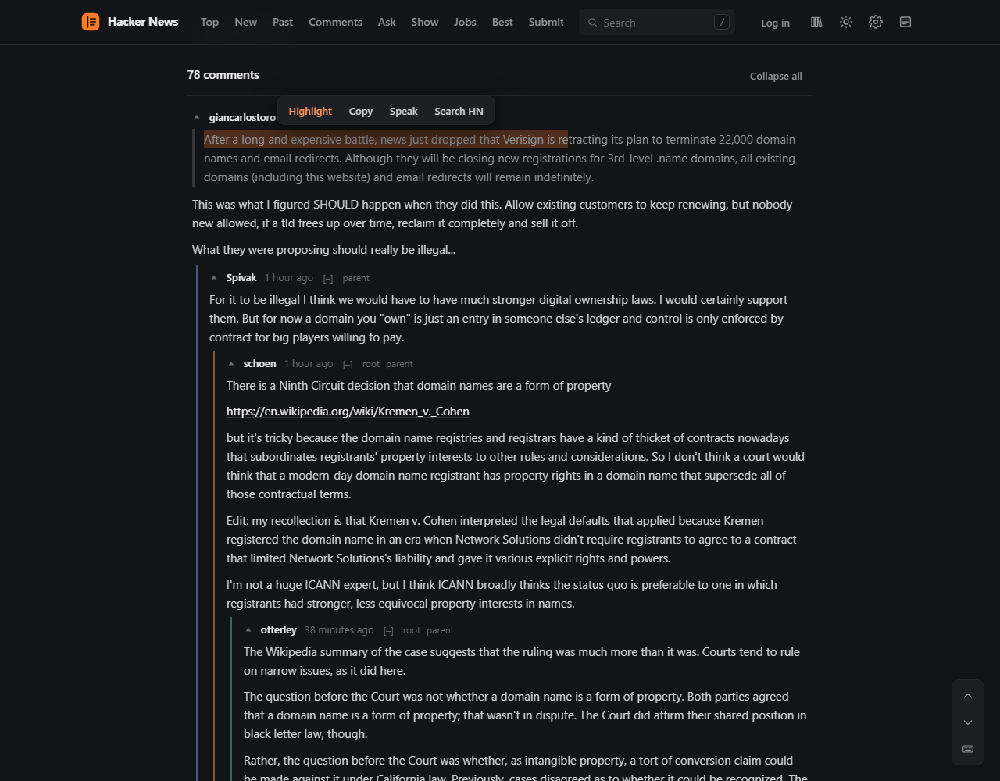
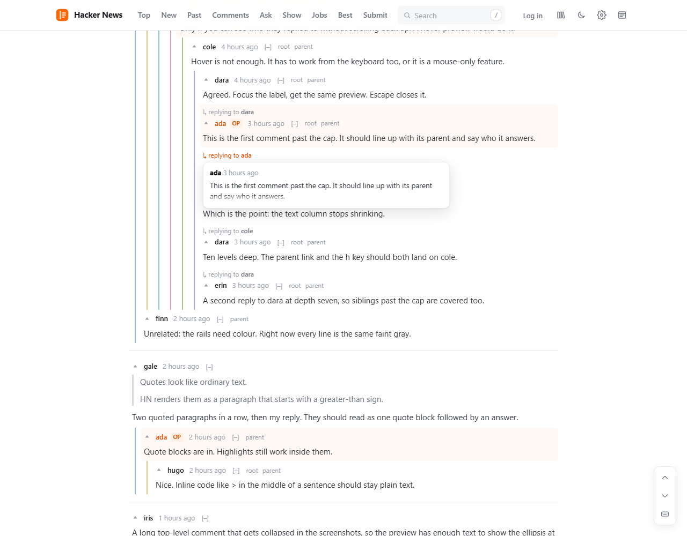
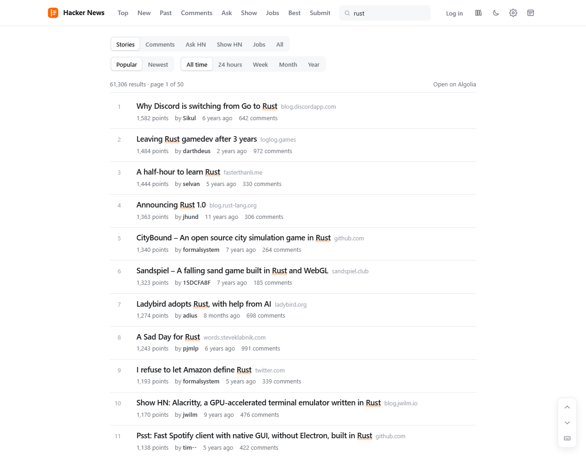
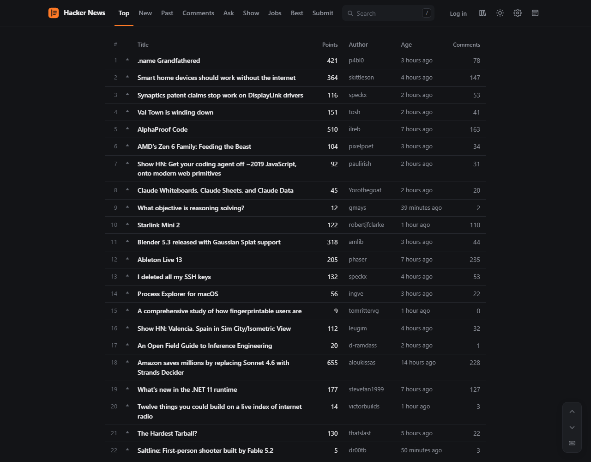
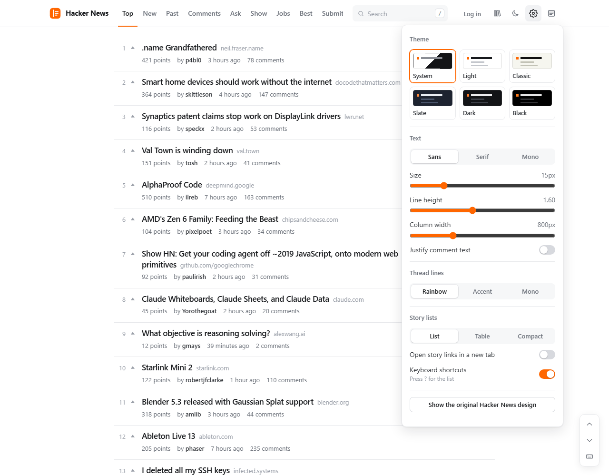
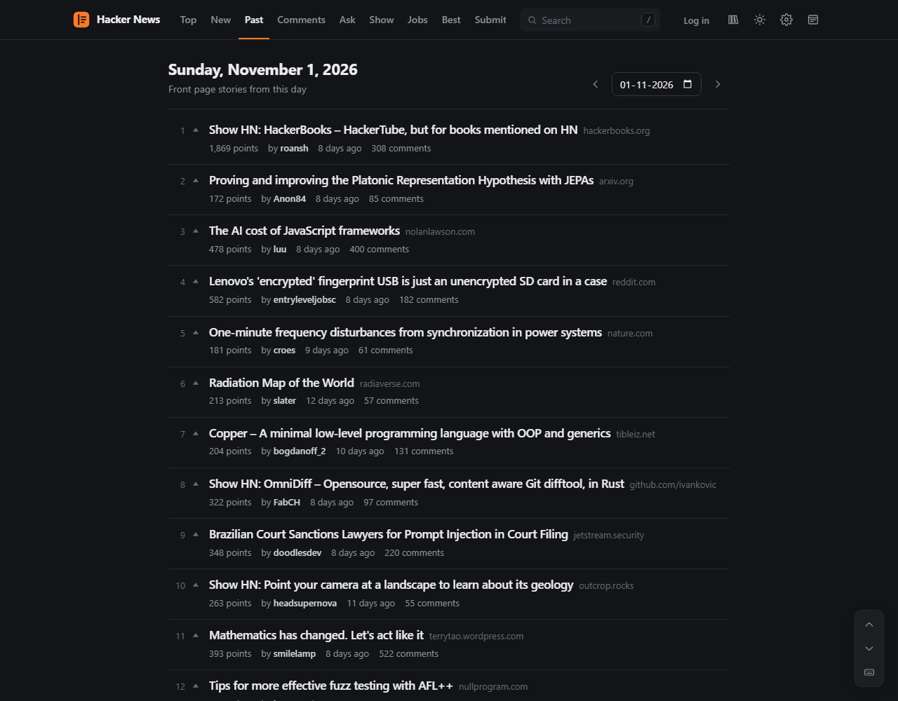

# Margin for Hacker News

Margin is a free browser extension for Chrome, Edge and Firefox that redesigns every page of [Hacker News](https://news.ycombinator.com). It works on page two and beyond, on `?next=` pagination, on past front pages, on profiles and on the account pages, because it picks a layout from the shape of each page instead of its URL.

Every feature is free. There is no account, no paid tier and no tracking.



## Screenshots

| | |
|---|---|
|  |  |
| Comment threads with depth-coloured lines and the selection menu | Deep threads stop indenting and show who each reply answers |
|  |  |
| Search without leaving the redesign | Table view, with the columns you choose |
|  |  |
| Themes, fonts, sizes and layout | Any past front page, with a date picker |

## Features

**Reading**

- Six themes (system, light, classic, slate, dark, black), three font families, and settings for text size, line height, column width and justified text. Settings also choose the list view, new-tab links, keyboard shortcuts, thread line colours and infinite scroll.
- Story lists in list, table (choose the columns) or compact view, on every page: page 2 and beyond, `newest?next=…`, past front pages, Ask, Show, Jobs, Best, `from?site=`, submissions and favorites.
- Infinite scroll on story and comment lists: the next page loads as you near the bottom, under a "Page N" divider that links to that page. The address bar follows the page you are reading, and the Back button returns to the same spot with every loaded page. It stops after ten pages for a Load more button, waits politely when HN rate-limits, and can be turned off in settings to get HN's More link back.
- A date picker for the front page of any past day.
- One click back to the original design, and one click to return.

**Comment threads**

- Depth-coloured thread lines (rainbow, accent or mono). Hover a line to light up its branch, and click it to collapse that branch.
- Quote blocks for `>` quotes, and code blocks that scroll instead of wrapping.
- Deep replies stop indenting after six levels and show "replying to …". Hover the label to preview the parent comment.
- Collapse from the line, the `[–]` button or the comment header. A collapsed comment shows a one-line preview and stays collapsed when you come back.
- Badges for comments that are new since your last visit, and keys to jump between them.
- An OP marker on comments by the story's author, plus "parent" and "root" links.
- Inline replies, without leaving the page.

**Your library**

- History of the stories you have read.
- Bookmarks for stories, comments and people.
- Highlights: select text in a story or comment and save it.
- Backup and restore of everything as one JSON file.

**Tools**

- Search from the top bar (press `/`). Search stories, comments, Ask HN, Show HN or jobs, sorted by popularity or date, over any time range, with matches marked.
- Profile cards when you hover a username, with karma, account age and about text.
- A selection menu on selected text: highlight, quote into your reply, copy, read aloud, or search HN.
- Every account action: vote, unvote, downvote, hide, favorite, flag, edit and delete.
- Keyboard shortcuts and an on-screen control pad. Press `?` on any page to see every key.

| Key | Action |
|---|---|
| `j` / `k` | Next / previous story or comment |
| `Shift+J` / `Shift+K` | Next / previous top-level thread |
| `h` / `r` | Parent / root comment |
| `x` | Collapse or expand |
| `n` / `p` | Next / previous new comment |
| `[` / `]` | Previous / next page (the page dividers, with infinite scroll) |
| `o` / `c` | Open the link / open the comments |
| `u` / `b` | Upvote / bookmark |
| `Shift+R` | Reply |
| `/` | Search |
| `l` / `g` | Open the library / back to top |
| `?` | Show all shortcuts |

## Install

Margin is not in the extension stores yet. Until it is, install it from a release or build it yourself.

### From a release

1. Download the zip for your browser from the [latest release](../../releases/latest): `…-chrome.zip` for Chrome, Edge, Brave, Helium, Opera and Vivaldi, or `…-firefox.zip` for Firefox.
2. Unzip it to a folder you will keep. The browser loads the extension from that folder, so do not delete it.
3. Follow the steps for your browser below, and choose the unzipped folder.

### Chrome, Edge, Brave, Helium, Opera and Vivaldi

1. Open the extensions page: `chrome://extensions` (Chrome, Helium, Brave and Vivaldi), `edge://extensions` (Edge) or `opera://extensions` (Opera).
2. Turn on **Developer mode**.
3. Select **Load unpacked** and choose the unzipped folder, or `.output/chrome-mv3` if you built from source.
4. Open [news.ycombinator.com](https://news.ycombinator.com).

To update, replace the folder's contents with the new version, then select the reload button on the extension's card. Your settings, history and bookmarks are kept.

### Firefox

1. Open `about:debugging#/runtime/this-firefox`.
2. Select **Load Temporary Add-on** and choose `manifest.json` inside the unzipped folder, or `.output/firefox-mv3/manifest.json` if you built from source.
3. If Firefox asks, allow the extension to access news.ycombinator.com. You can also allow it from the extension's entry in `about:addons`, under **Permissions**.

Firefox removes a temporary add-on when it closes. It installs unsigned add-ons permanently only in Firefox Developer Edition or Nightly, with `xpinstall.signatures.required` set to `false` in `about:config`. The add-ons store version will not have this limit.

### From source

You need Node 22 and pnpm 10.

```sh
git clone <this repository>
cd <the cloned folder>
pnpm install
pnpm build         # writes .output/chrome-mv3 and .output/firefox-mv3
```

Then load the folder for your browser as described above.

## Privacy

Margin stores everything in your browser's extension storage (`chrome.storage.local`). It has no server, no analytics and no remote code. It makes network requests to two places. Requests to `news.ycombinator.com` use your existing HN session, for the same actions HN's own links perform: votes, favorites, hides, flags, replies, and the profile shown in a hover card. When you search, your search words and filters go to `hn.algolia.com`, the search service HN itself links to, without cookies or any other data. Links you click go where they point, as they would without the extension.

The extension asks for one permission, `storage`, and access to `https://news.ycombinator.com/*`.

## Develop

You need Node 22 and pnpm 10.

```sh
pnpm install
pnpm test          # parser fixtures and store tests (Vitest)
pnpm check         # type check, then tests
```

The parser tests load every page in `fixtures/` (real HN HTML captured logged out, plus three hand-written logged-in pages in `fixtures/synthetic/`) and assert the page kind and parsed values.

Margin never uses WXT's dev server, because it opens a browser window. Build instead, then load the build.

## Build

```sh
pnpm build         # .output/chrome-mv3 and .output/firefox-mv3
pnpm zip           # store zips in .output/, plus a sources zip for Firefox review
pnpm icons         # regenerate public/icon/*.png from scripts/icons.mjs
```

Before you publish to addons.mozilla.org, replace the placeholder Gecko id in `wxt.config.ts`.

## Headless checks

These scripts run Chrome for Testing headless with the built extension. They answer every `news.ycombinator.com` request from `fixtures/` and every `hn.algolia.com` search from `fixtures/algolia/`, so they never contact HN or Algolia and never open a window.

```sh
pnpm dlx @puppeteer/browsers install chrome@stable --path .cache/browsers
pnpm build:chrome
pnpm e2e [filter]                # behaviour checks: votes, replies, keys, history, highlights, toggle, search, infinite scroll
node scripts/shots.mjs [outDir]  # screenshots of each page kind in each theme
```

## How it works

`src/hn/` turns an HN page into one typed `Page` value. A registry of detectors picks the parser from the DOM shape (`table.fatitem`, the profile table, comment rows, story rows), so any URL that produces a known shape gets the new design. `src/ui/` renders that value with Preact, and `src/store/` is the only code that reads or writes extension storage. `src/search/` turns a search URL into an Algolia request and the response into results. See `DESIGN.md` for the data shapes and the runtime flow.

Hacker News is a trademark of Y Combinator. Margin is not affiliated with Y Combinator.
